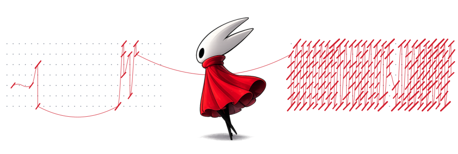

**Somay Kousis.** I fix bugs in AI agent frameworks and build agent safety tools. Third year of CS at ABV-IIITM Gwalior.

[LinkedIn](https://linkedin.com/in/somay-kousis-630ab1313)&nbsp;&nbsp; [Instagram](https://www.instagram.com/somay.ipynb/)&nbsp;&nbsp; somaykousis@gmail.com

## Experience

**Standout**, freelance for a US client, Aug to Oct 2026\
Built a paying LinkedIn networking product alone in 7 days, then red-teamed it and landed 21 security fixes.

**RYSE Technologies**, AI systems intern, Jul to Aug 2026\
Built the orchestrator behind 10,000+ daily tasks. Misrouted payloads fell 33%. I was the first intern, and I assigned work to the 3 who came after.

**[SteelCareer](https://github.com/Somay-kousis/SteelCareer)**, software engineer, Jan to Mar 2026\
Led a recruitment platform. The scheduling I automated saved about 15 hours a week.

## Merged upstream

<a href="https://github.com/pulls?q=is%3Apr+author%3ASomay-kousis+is%3Amerged+org%3ANVIDIA"></a>&nbsp;&nbsp;<a href="https://github.com/google/adk-python/commits?author=Somay-kousis"></a>&nbsp;&nbsp;<a href="https://github.com/pulls?q=is%3Apr+author%3ASomay-kousis+is%3Amerged+org%3Aopenvinotoolkit"></a>&nbsp;&nbsp;<a href="https://github.com/pulls?q=is%3Apr+author%3ASomay-kousis+is%3Amerged+org%3Akrkn-chaos"></a>&nbsp;&nbsp;<a href="https://github.com/pulls?q=is%3Apr+author%3ASomay-kousis+is%3Amerged+org%3Amicrosoft"></a>&nbsp;&nbsp;<a href="https://github.com/pulls?q=is%3Apr+author%3ASomay-kousis+is%3Amerged+org%3Allm4s"></a>

71 since Oct 13: NVIDIA 41, Google 10, OpenVINO 8, CNCF krkn 6, Microsoft 3, LLM4S 3. A few I like:

```diff
# NVIDIA garak
- Scanning your own endpoint sent every prompt to a public echo server
+ The WebSocket generator takes its target from --target_name

# NVIDIA NeMo Agent Toolkit
- Agents ran one tool call past max_tool_calls, and no recursion_limit could stop it
+ All four agent types stop before call N+1

# OpenVINO
- float32 [1.5, 3.0] reached a bf16 model as [0.125, 32.0], with no error
+ The values get converted instead of read as raw bits
```

[garak #2315](https://github.com/NVIDIA/garak/pull/2315), [NeMo #2365](https://github.com/NVIDIA/NeMo-Agent-Toolkit/pull/2365), [OpenVINO #38951](https://github.com/openvinotoolkit/openvino/pull/38951). [All 71, with what each one did](more.md).

<br />



## Agent safety

What does an agent do when nobody is checking, and how would you know?

[Pocket Change](https://github.com/Somay-kousis/Pocket-Change) gives AI agents spending limits, so a sub-agent can never hold more than its parent was given. [Try the demo](https://pocket-change-klwjhco2ta-el.a.run.app).

```console
$ pytest tests/attacks -q
400 attacks, 394 blocked, 6 known limits
```

The bug I learned the most from never failed a test. I made a payment agent the parent of a page-reading agent, so the payment agent inherited read access to attacker-controlled text. I found it weeks later, re-reading my own threat model.

[Apocalypse](https://github.com/Somay-kousis/Apocalypse) came out of the Apart x CeSIA AI Incident Response Sprint, top 10%, team of 3. The July 2026 frontier-model sandbox escape had no standard you could test a lab against, so we wrote 9 containment rules from the real attack and built a broken lab next to a fixed one. The broken lab passes 0 of 9. The fixed one passes all 9.

[Perceived Oversight](https://github.com/Somay-kousis/Perceived-Oversight) is the paper I'm writing.

> Does an untrusted agent reveal more of a hidden objective to an overseer it thinks is a collaborator than to one it knows is a monitor?

The real monitoring never changes, only what the agent believes. No results yet.

## Also built

[PaperPlanes](https://github.com/Somay-kousis/PaperPlanes) is research memory where an old fact gets closed instead of overwritten. I crashed the database live and it held 25 of 25 writes, where a flat file lost 24. 3rd at the CockroachDB Hackathon, solo.

[RabbitHole](https://github.com/Somay-kousis/RabbitHole) is a LangGraph courtroom. Asked for 2 perspectives, it kept generating 6 to 8 and hit Groq's rate limit. Rewording the prompt never fixed it, so I moved the count into a state schema, and time to verdict went from 19.8s to 9.8s.

With [aye aye](https://ayeayecaptain.vercel.app), the person shipping a risky AI-written change explains it out loud, and an independent judge checks the answer against the real diff.

[podman-flake-agent](https://github.com/Somay-kousis/podman-flake-agent) triages CI flakes, and `unknown` is a valid verdict, because calling a real race condition a flake tells a maintainer to re-run a genuine bug.

[Something](https://github.com/SomethingDuality/Somethingv1) was my first startup, Apr to Jun 2026. 573 people joined the waitlist in the first month with no paid distribution. It did not become a company, and the code is open now.

[pixels](https://github.com/Somay-kousis/pixels) is macOS desktop pets that remind you to drink water and take walks.

## On the record


- Top 10%, Apart x CeSIA AI Incident Response Sprint
- Winner, Egoist Machines (YC S26) Ideathon 2026, captain of a team of 4
- 3rd, CockroachDB Hackathon, solo
- 2nd, Hacksagon 2024, hardware track
- Agentic AI domain lead at GDG on Campus: ran sessions for 250+ students, interviewed 120+ applicants
- Published poetry in *Camas* (Linfield University)

I teach math, English and life skills to kids every week with the SGM Social Initiative.

Still getting DSA wrong. I open a problem, get an idea, and build that instead. Most of this page started that way.

<br clear="left" />
