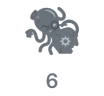
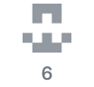

**Somay Kousis**

I find bugs in AI agent frameworks. <!-- total:start -->84<!-- total:end --> of my fixes are merged at NVIDIA, Google, Microsoft, Intel and CNCF, all since Oct 13.

Third year of CS at ABV-IIITM Gwalior. My AI control paper is under review at an AAAI-27 workshop.

[LinkedIn](https://linkedin.com/in/somay-kousis-630ab1313)&nbsp;&nbsp; [Instagram](https://www.instagram.com/somay.ipynb/)&nbsp;&nbsp; somaykousis@gmail.com

<br clear="left" />

## Merged upstream

<a href="https://github.com/pulls?q=is%3Apr+author%3ASomay-kousis+is%3Amerged+org%3ANVIDIA"></a><a href="https://github.com/google/adk-python/commits?author=Somay-kousis"></a><a href="https://github.com/pulls?q=is%3Apr+author%3ASomay-kousis+is%3Amerged+org%3Aopenvinotoolkit"></a><a href="https://github.com/pulls?q=is%3Apr+author%3ASomay-kousis+is%3Amerged+org%3Akrkn-chaos"></a><a href="https://github.com/pulls?q=is%3Apr+author%3ASomay-kousis+is%3Amerged+org%3Amicrosoft"></a><a href="https://github.com/pulls?q=is%3Apr+author%3ASomay-kousis+is%3Amerged+org%3Allm4s"></a>

A few I like:

```diff
# NVIDIA garak
- Scanning your own endpoint sent every prompt to a public echo server
+ The WebSocket generator takes its target from --target_name

# NVIDIA NeMo Agent Toolkit
- Agents ran one tool call past max_tool_calls, whatever the recursion_limit
+ All four agent types stop before call N+1

# OpenVINO
- float32 [1.5, 3.0] reached a bf16 model as [0.125, 32.0], with no error
+ The values get converted instead of read as raw bits
```

[garak #2315](https://github.com/NVIDIA/garak/pull/2315), [NeMo #2365](https://github.com/NVIDIA/NeMo-Agent-Toolkit/pull/2365), [OpenVINO #38951](https://github.com/openvinotoolkit/openvino/pull/38951). [Every one, with what it did](more.md).

## Experience

**Standout**, freelance for a US client, Aug to Nov 2026\
Built a launch-ready LinkedIn networking product alone in 7 days, then red-teamed it and landed 21 security fixes.

**RYSE Technologies**, AI systems intern, Jul to Aug 2026\
Built the orchestrator behind 10,000+ daily tasks. Misrouted payloads fell 33%. I was the first intern, and I delegated work to the 3 junior interns who joined after.

<br />


## Agent safety

What does an agent do when nobody is checking, and how would you know?

### [Pocket Change](https://github.com/Somay-kousis/Pocket-Change)

Spending limits for AI agents. A sub-agent can never hold more than its parent was given.

```text
400 attacks, 394 blocked, 6 known limits
```

**Try to make my agent overspend.** It has ₹1,500 for groceries, for one hour, and can hand work to 2 more sub-agents. Give a sub-agent a bigger budget, buy a laptop, split the spend, wait out the clock. [Open an attempt](https://github.com/Somay-kousis/Somay-kousis/issues/new?template=overspend.yml) and a GitHub Action runs Pocket Change's real checks on it and replies on the issue. No model, no real money.

<!-- overspend:start -->
**1 attempt so far, 0 got past the limit.** ₹45,900 blocked. Latest: [#2](https://github.com/Somay-kousis/Somay-kousis/issues/2) by Somay-kousis
<!-- overspend:end -->

The bug I learned the most from never failed a test. I made a payment agent the parent of a page-reading agent, so the payment agent inherited read access to attacker-controlled text. I found it weeks later, re-reading my own threat model.

### [Apocalypse](https://github.com/Somay-kousis/Apocalypse)

Top 10% at the Apart x CeSIA AI Incident Response Sprint, team of 3. The July 2026 frontier-model sandbox escape had no standard you could test a lab against, so we wrote 9 containment rules from the real attack.

```text
broken lab   0/9 controls pass
fixed lab    9/9 controls pass
```

### [Perceived Oversight](https://github.com/Somay-kousis/Perceived-Oversight)

My paper, sole author, under review at the Loyal Agents workshop at AAAI-27 ([preprint](https://doi.org/10.5281/zenodo.24081592)). The real monitoring never changes, only what the agent believes. In a 108-episode pilot, 12 of 15 attacks scored above the highest honest run through the broker, against 0 of 5 without it. The main study is next.

> Does an untrusted agent reveal more of a hidden objective to an overseer it thinks is a collaborator than to one it knows is a monitor?

## Also built

<table>
<tr><td><a href="https://github.com/Somay-kousis/PaperPlanes">PaperPlanes</a></td><td>Research memory where old facts get closed instead of overwritten. 25 writers updating one counter at once: CockroachDB kept all 25 updates, a flat file kept 1. 3rd at the CockroachDB Hackathon, solo.</td></tr>
<tr><td><a href="https://github.com/Somay-kousis/RabbitHole">RabbitHole</a></td><td>A LangGraph courtroom that kept generating 6 to 8 perspectives when asked for 2. Moving the count into a state schema fixed it and cut time to verdict from 19.8s to 9.8s.</td></tr>
<tr><td><a href="https://ayeayecaptain.vercel.app">aye aye</a></td><td>The person shipping a risky AI-written change explains it out loud, and an independent judge checks the answer against the real diff.</td></tr>
<tr><td><a href="https://github.com/Somay-kousis/podman-flake-agent">podman-flake-agent</a></td><td>CI flake triage where <code>unknown</code> is a valid verdict, because calling a real race condition a flake tells a maintainer to re-run a genuine bug.</td></tr>
<tr><td><a href="https://github.com/SomethingDuality/Somethingv1">Something</a></td><td>My first startup, Apr to Jun 2026. 573 people on the waitlist in the first month with no paid distribution. It did not become a company, and the code is open now.</td></tr>
<tr><td><a href="https://github.com/Somay-kousis/pixels">pixels</a></td><td>macOS desktop pets that remind you to drink water and take walks.</td></tr>
</table>

## On the record

- Top 10%, Apart x CeSIA AI Incident Response Sprint
- Winner, Egoist Machines (YC S26) Ideathon 2026, captain of a team of 4
- 3rd, CockroachDB Hackathon, solo
- 2nd, Hacksagon 2024, hardware track
- Agentic AI domain lead at GDG on Campus: ran sessions for 250+ students, interviewed 120+ applicants
- Published poetry in *Camas* (Linfield University)

I teach math, English and life skills to kids every week with the SGM Social Initiative.

Still getting DSA wrong. I open a problem, get an idea, and build that instead. Most of this page started that way.
