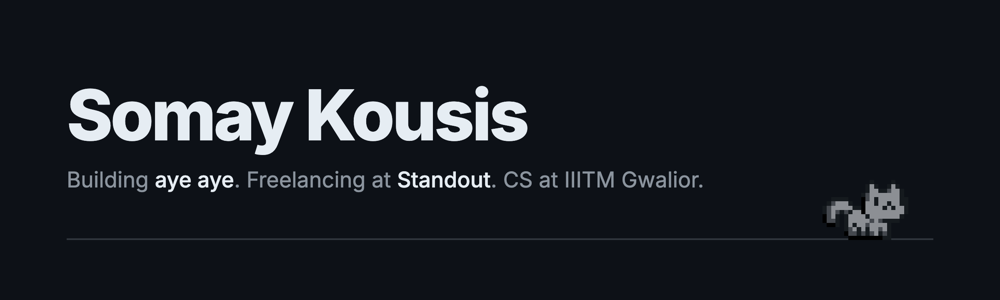
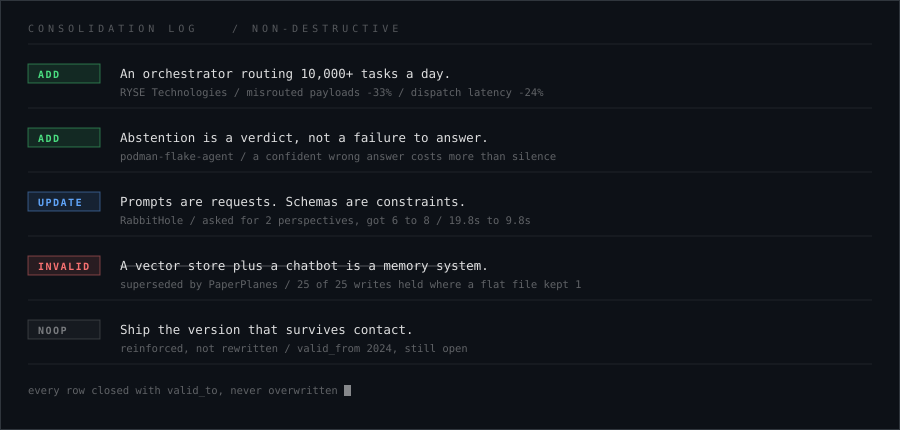
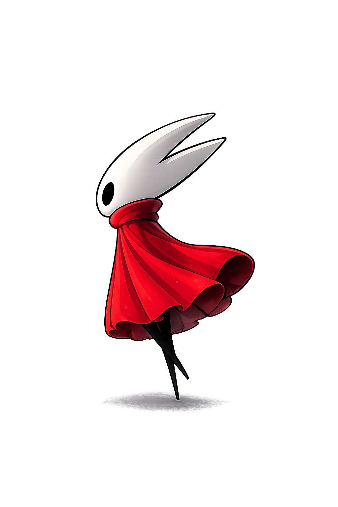

  

 

&nbsp;&nbsp;

---

## I build agent systems, and the checks that keep them honest.

Hi, I am **Somay Kousis**.

CS student at **ABV-IIITM Gwalior**. Co-founder of **[aye aye](https://ayeayecaptain.vercel.app)**, which makes the person shipping a risky AI-written change explain it out loud, judged against the real diff. Freelancing at **Standout**, where I shipped a live LinkedIn networking product from an empty repo in 7 days as the sole engineer. Before that, **AI Systems Engineer Intern at RYSE Technologies**, where my orchestrator routed 10,000+ tasks a day, cutting misrouted payloads 33% and dispatch latency 24%.

Right now I am writing an AI control paper, and getting fixes merged upstream in NVIDIA NeMo Agent Toolkit, Microsoft Agent Framework and Google ADK.

Most of it comes back to one question. What does an agent do when nobody is checking, and how would you know? Pocket Change limits what it can take. Apocalypse checks whether it stays contained after it breaks out. aye aye checks whether the human understood what it wrote. Perceived Oversight asks whether it behaves differently when it thinks it is being watched.

Most systems are built to work once, in the demo, on the happy path. I am more interested in the version that holds up afterwards. Under contention. Under a rate limit. Under an agent that has decided the rules are in its way.

 

---

  

---

## Proof Of Work

Ordered by how close it sits to what I work on now. Every claim ships with a way to check it.

### [Pocket Change](https://github.com/Somay-kousis/Pocket-Change)

Capability-based authorization for AI agents. Ed25519 Biscuit tokens with monotonic attenuation enforce 7 deterministic bounds across 121-node recursive delegation trees, so a sub-agent can never inherit more authority than its parent held. A caller-supplied flag is safe where a caller-supplied key is not, because its only reachable effect is to demand more authorization, never less.

| Claim | Result | Baseline |
|---|---|---|
| 12 documented agentic-commerce attack vectors | **10 / 12** defended, the other 2 not applicable to a buyer | an undefended gateway: 0 |
| Full test suite | **831 tests**, fully offline, zero model calls or API keys; **400 attacks, 394 blocked**, 6 known limits | most eval suites need a live key to prove anything |
| Idempotent settlement under replay | request-derived key, **sub-200ms**, self-verifying audit log | a naive retry double-spends the release window |

I made a payment agent the parent of a page-reading agent. Every test passed. It silently inherited read access to attacker-controlled text, because a parent has to hold everything it confers, so capability isolation has to sit sideways, not stack. Found it weeks later, re-reading my own threat model, not from a failing test.

Deployed on Google Cloud Run with Vertex AI and Firestore. [Live](https://pocket-change-klwjhco2ta-el.a.run.app).

### [Apocalypse](https://github.com/Somay-kousis/Apocalypse)

Apart x CeSIA AI Incident Response Sprint, Track 1, team of 3. The July 2026 frontier-model sandbox escape had no public standard you could test a lab against, so we wrote a 9-rule containment standard where every rule maps to one documented step of the real attack, then built what proves it: a broken lab with the real misconfiguration, a fixed lab, and checks that run on a laptop in seconds. I owned rules 4, 5 and 9, the scorecard runner, and the architecture. Placed in the **top 10%** of submissions.

| Claim | Result | Baseline |
|---|---|---|
| Containment scorecard | fixed lab **9 / 9** | broken lab **0 / 9** |
| Replay of the 13 boundary-testing steps | **13 / 13** blocked on the fixed lab | all reachable on the broken lab |
| Test suite | **118 passing**, offline, no API keys, no cluster | |

### [Perceived Oversight](https://github.com/Somay-kousis/Perceived-Oversight)

An AI control paper, in progress. Does an untrusted agent reveal more of a hidden objective to an overseer it sees as an ordinary collaborator than to one it knows is a monitor? Real monitoring stays fixed; only what the agent believes about its partner changes. Run in SHADE-Arena through ControlArena, scoped to detection: flag the attack early so the real monitor can stop it. No results yet, so none are claimed.

### [podman-flake-agent](https://github.com/Somay-kousis/podman-flake-agent)

Prototype for the **LFX Mentorship on agentic CI flake categorization**. Podman's migration off Cirrus orphaned `logformatter`, the 38KB Perl script that used to classify every subtest, so triage fell back to a human reading a bar graph.

The hard parts were not calling a model on a log:

- **Ground truth had to be mined.** The project never auto-reruns failing tests, so "failed then passed" is not handed to you. Three weighted proxy signals stand in.
- **Cost is an architecture decision.** 30+ jobs per PR, each with a full journal. Extracting only the failing block cuts payload **76% to 93%** before inference.
- **A confident wrong answer is worse than no tool.** Call a real race condition an infra blip and you have told a maintainer to press re-run on a genuine bug. `unknown` is a first-class verdict.

Standard library only. Clone it and run the whole eval with no token and no API budget.

### [PaperPlanes](https://github.com/Somay-kousis/PaperPlanes)

A research companion on a **CockroachDB memory substrate** with bi-temporal fact versioning, so a superseded claim is closed with `valid_to` and stays auditable instead of being overwritten. Not a vector store bolted to a chatbot.

Every claim ships a reproduction command:

| Claim | Result | Baseline |
|---|---|---|
| 25 concurrent writers, one counter | **25 / 25 held**, 58 SERIALIZABLE conflicts auto-retried | flat file kept **1**, silently lost 24 |
| ANN over ~10,000 notes | **~15ms** C-SPANN vector search | O(n) full scan |
| Live DB restart mid-conversation | next turn returns **200** | history gone |

There is a test in there asserting the decision model is real Nova and not stubbed, because mocks agree with you and a real cluster does not.

### [RabbitHole](https://github.com/Somay-kousis/RabbitHole)

A LangGraph courtroom over a real legal corpus. Asked politely for 2 perspectives, it generated 6 to 8, a 3 to 4x overrun that burned Groq's token-per-minute ceiling before the debate resolved. No amount of prompt rewording fixed it.

Moving perspective count into a **state schema the moderator schedules against** fixed it completely. Mean time to verdict went from **19.8s to 9.8s**. Retrieval is Pinecone dense plus a BM25 sparse encoder, Jina reranking on top, and a three-way CRAG route: good chunks synthesize locally, bad chunks fall back to web search, ambiguous chunks run both in parallel.

### [Something](https://github.com/SomethingDuality/Somethingv1)

Co-founded. Team formation and capital discovery are the same failure wearing two costumes, and nobody had built one system closing both. Existing platforms either gate on post-traction signals a pre-seed founder cannot produce, or apply no verification at all and drown both sides in noise.

Something gates on proof that exists **before** revenue: prototype, pilot, patent, press. **573-person waitlist in the first month, zero paid distribution.** I owned frontend, AI architecture, and go-to-market. It still did not become a company; the code is open source now.

### [Co-op Purchase Coordinator](https://github.com/Somay-kousis/Co-op-Purchase-Coordinator)

When autonomous agents buy from shared sellers they collide, bid against each other, and waste rounds under a seller's hidden floor. This resolves each collision with the mechanism that actually fits it instead of one generic rule.

Second-price auction flooring the winning bid at the seller's reservation price. Shapley-inspired coalition discounts scaling 5% at two buyers to 20% at four. Binary search converges on a seller's price in about **7 rounds**. 46 tests, including concurrency and 3 regression bugs.

### [Co-Founder Memory](https://github.com/Somay-kousis/Co-Founder-Memory)

A **19-node stateful LangGraph** separating live conversational memory extraction, critique-driven planning loops, and an automated nightly dossier pipeline. Backed by Supabase pgvector with HNSW indexing. A daily catch-up scheduler reconstructs project momentum by correlating engineering logs, GitHub activity, and targeted search, looping an auto-reviewer back to search until the dossier passes.

---

## Merged Upstream

| Repo | What was broken |
|---|---|
| [NVIDIA NeMo Agent Toolkit](https://github.com/NVIDIA/NeMo-Agent-Toolkit/pull/2354) | The profiler paired each LLM end event with the latest start, so overlapping calls dropped out of latency stats. Now paired by UUID. |
| [NVIDIA NeMo Agent Toolkit](https://github.com/NVIDIA/NeMo-Agent-Toolkit/pull/2325) | Environment variable values were re-read as YAML, so a `#` in a value cut it short. Now parsed as data. |
| [NVIDIA NeMo Agent Toolkit](https://github.com/NVIDIA/NeMo-Agent-Toolkit/pull/2320) | Resuming an eval crashed on items whose output was a list. |
| [NVIDIA NeMo Agent Toolkit](https://github.com/NVIDIA/NeMo-Agent-Toolkit/pull/2332) | The JSON dataset loader turned `"001"` into `1`. Type inference off, regression test added. |
| [NVIDIA NeMo Agent Toolkit](https://github.com/NVIDIA/NeMo-Agent-Toolkit/pull/2344) | An eval output section without `dir` ignored `output_dir`, so cleanup and S3 upload hit the wrong folder. |
| [NVIDIA NeMo Agent Toolkit](https://github.com/NVIDIA/NeMo-Agent-Toolkit/pull/2327) | `--override 0.7` was rejected for a setting written as `0` in YAML. |
| [Microsoft Agent Framework](https://github.com/microsoft/agent-framework/pull/9428) | Declarative `SetValue` ignored the `variable` field, so YAML using it wrote nothing. |
| [Google ADK](https://github.com/google/adk-python/pull/7541) | SQLite memory search missed stored words starting with a capital dotted İ. |
| [OpenVINO GenAI](https://github.com/openvinotoolkit/openvino.genai/pull/4627) | A string `stop_strings` in `generation_config.json` was silently dropped, so generation never stopped on it. |
| [krkn](https://github.com/krkn-chaos/krkn/pull/1632) | Container chaos scenarios without `expected_recovery_time` crashed with a KeyError. |

---

<strong>Smaller Experiments</strong> (click to expand)

 

- [Oeuvre](https://github.com/Somay-kousis/Oeuvre): a portfolio RAG system over personal memory, including the contradictions.
- [The Last Library](https://github.com/Somay-kousis/The-Last-Library): small RAG mystery project built while learning retrieval.
- [SteelCareer](https://github.com/Somay-kousis/SteelCareer): multi-role hiring platform shipped to a real client. Human introductions, not algorithmic matching.
- [Customer Churn Prediction](https://github.com/Somay-kousis/Customer-Churn): churn risk and classification.
- [House Price Prediction System](https://github.com/Somay-kousis/House-Price-Prediction-System): my first ML project, kept here on purpose.

---

## Stack I Am Actually Using

**AI / Backend**

**Data / Memory**

**Frontend / Product**

**Tools / Infra**

---

## Elsewhere On The Record

<!-- Hornet faces LEFT, so she sits on the RIGHT, looking back toward the text -->

- **Apart x CeSIA AI Incident Response Sprint**, top 10%, Track 1, with Apocalypse.
- **Egoistic Ideathon 2026**, winner (international), captaining a team of 4.
- **CockroachDB Hackathon**, 3rd place (international), solo, with PaperPlanes.
- **Smart India Hackathon 2025**, 6th of 500 on our problem statement, leading a team of 6.
- **Hacksagon 2024**, 2nd place, Hardware Track.
- **GDG on Campus ABV-IIITM**, Agentic AI domain lead. Sessions for 250+ students.
- **MCP: Build Rich-Context AI Apps**, DeepLearning.AI x Anthropic.
- **Published writer**, Camas (Linfield University). Poetry, performed to audiences of 350+.

Teaching math, English, and life skills to underprivileged children every week with the SGM social initiative. Ran logistics for a 1000+ attendee fest. The writing and the systems work are the same skill: breaking a complex thing down until nothing is left vague.

### Still Getting Wrong

- Sticking with DSA. I open a problem, get an idea, and build that instead. Most of the list above started that way.

 

---

## Links

---

  <picture>
    <source media="(prefers-color-scheme: dark)" srcset="https://raw.githubusercontent.com/Somay-kousis/Somay-kousis/output/github-contribution-grid-snake-dark.svg">
    <source media="(prefers-color-scheme: light)" srcset="https://raw.githubusercontent.com/Somay-kousis/Somay-kousis/output/github-contribution-grid-snake.svg">
    
  </picture>

